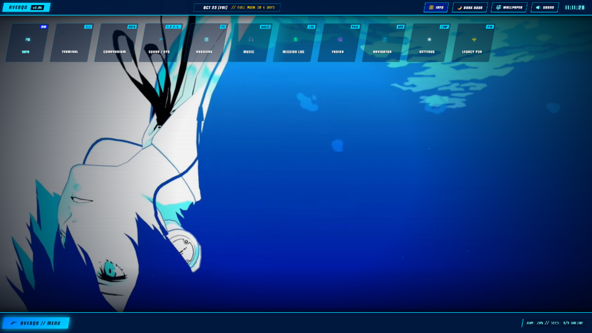
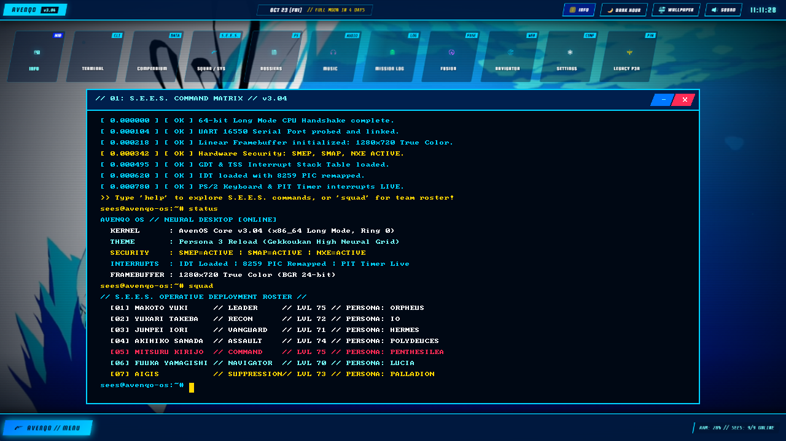

<div align="center">

# 🌙 AvenOS (AVENQO OS)

**A 64-bit Hardened Bare-Metal Operating System in Rust with Persona 3 Reload Aesthetics**

[](https://opensource.org/licenses/Apache-2.0)
[](https://www.rust-lang.org/)
[]()
[]()

*"Wake up, get up, get out there."*

</div>

---

## 📸 Screenshots

| Clean Desktop (Persona 3 Reload HUD) | S.E.E.S. Command Matrix Window Active |
| :---: | :---: |
|  |  |

---

## ✨ Features

- **Built 100% From Scratch in `#![no_std]` Rust**: No Linux kernel, no C runtime (`libc`), and no dependencies on existing operating systems. Runs directly on bare-metal x86_64 hardware.
- **Hardware Security Mitigations**:
  - **SMEP** (Supervisor Mode Execution Prevention) to prevent executing user-space memory with kernel privileges.
  - **SMAP** (Supervisor Mode Access Prevention) to block accidental supervisor access to user pages.
  - **NXE** (No-Execute Enable) for strict page-level execution control (DEP/W^X).
- **Safe Stack & Fault Handling**:
  - Custom **GDT** (Global Descriptor Table) and **TSS** (Task State Segment).
  - Dedicated **IST** (Interrupt Stack Table) for Double Faults, preventing fatal triple faults during kernel stack overflows.
- **Interrupts & PIC**:
  - Full **IDT** (Interrupt Descriptor Table) implementation.
  - Remapped dual **8259 PIC** (Timer on IRQ 0, Keyboard on IRQ 1).
  - Programmable Interval Timer (**PIT**) driving non-blocking cursor blinking and task scheduling.
  - **PS/2 Keyboard Controller** with scancode translation.
- **Zero-Heap High Performance Graphics Engine**:
  - Direct **Linear Framebuffer** rendering (`1280x720 True Color`).
  - Custom zero-heap **QOI (Quite OK Image)** decoder implemented natively in `#![no_std]` Rust to blit high-resolution artwork directly to VRAM.
  - Slanted parallelogram panels and bitmap font rendering with sub-millisecond drawing times.
- **S.E.E.S. Command Matrix Terminal**:
  - Circular line history buffer, interactive keyboard input, and command processor.
  - Built-in directives: `help`, `status`, `squad`, `compendium`, `lunar`, `darkhour`, `neofetch`, `clear`, `echo`, `reboot`, and `panic`.

---

## 🛠️ Project Structure

```
AvenOS/
├── .cargo/               # Cargo workspace configuration
├── .gitignore            # Clean git exclusion rules
├── Cargo.toml            # Workspace manifest
├── rust-toolchain.toml   # Rust nightly toolchain specification
├── assets/               # Repository documentation screenshots
├── kernel/               # The 64-bit bare-metal operating system kernel
│   ├── Cargo.toml
│   └── src/
│       ├── main.rs       # Kernel entry point and boot coordination
│       ├── security.rs   # SMEP, SMAP, and NXE CPU mitigation enforcement
│       ├── gdt.rs        # Global Descriptor Table & TSS with IST stacks
│       ├── interrupts.rs # IDT exception handling & 8259 PIC handlers
│       ├── serial.rs     # 16550 UART COM1 serial logger
│       ├── shell.rs      # Interactive S.E.E.S. Command Matrix terminal
│       └── graphics/
│           ├── mod.rs        # Framebuffer sync and panic screen
│           ├── color.rs      # P3R color definitions
│           ├── framebuffer.rs# Linear framebuffer drawing primitives
│           ├── dashboard.rs  # Desktop HUD integration
│           ├── qoi.rs        # Zero-heap QOI image decoder
│           └── wallpaper.qoi # Embedded 1280x720 Persona 3 desktop asset
└── runner/               # Boot packaging utility using bootloader crate
    ├── Cargo.toml
    └── src/main.rs       # Packages kernel ELF into bootable BIOS disk image
```

---

## 🚀 Building & Running

### Prerequisites

- [Rust](https://rustup.rs/) (Nightly toolchain, automatically selected via `rust-toolchain.toml`)
- `rust-src` component:
  ```bash
  rustup component add rust-src --toolchain nightly
  ```
- [QEMU](https://www.qemu.org/) (`qemu-system-x86_64`)

### Build the Kernel and Boot Image

To build the kernel ELF and package it into a bootable BIOS disk image:

```bash
cargo run --package runner -- --build-only
```

This generates `target/aven_os_bios.img`.

### Run in QEMU

Run the OS directly with:

```bash
cargo run --package runner
```

Or invoke QEMU manually:

```bash
qemu-system-x86_64 \
  -drive format=raw,file=target/aven_os_bios.img \
  -serial stdio \
  -m 256M
```

---

## 📜 License

Licensed under the Apache License, Version 2.0. See [LICENSE](LICENSE) for details.
